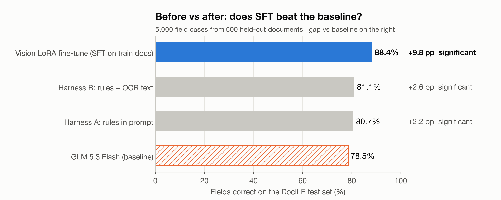
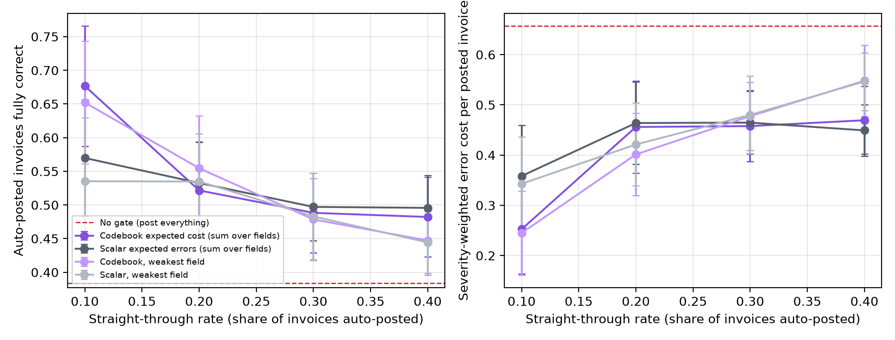
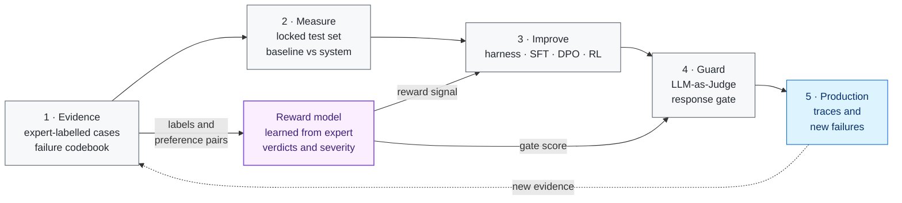
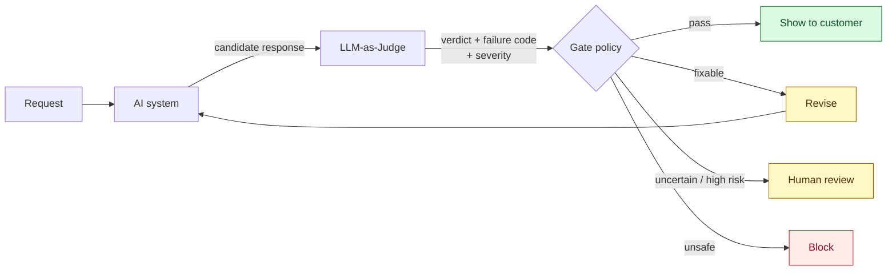
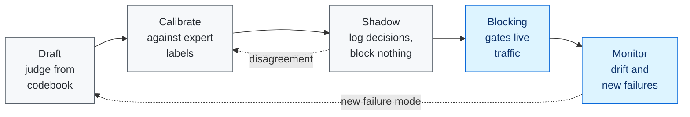

# GEDD: Grounded Evidence Driven Development

**GEDD turns domain-expert judgment into one failure codebook, then derives your evaluation, your training reward and your response gate from it.**

---

## Latest findings

*Updated 2026-11-03. Every number below is regenerated from saved per-case results by a script in this repo. Null results are reported alongside the wins.*

### ✅ Proven: a GEDD round beats the off-the-shelf model on real invoices

On 500 held-out scanned invoices from DocILE (5,000 field cases across 204 layouts), a vision LoRA fine-tune of an open model raised field accuracy from **78.5% to 88.4%**. Invoices with all 10 fields right **tripled, from 12.8% to 38.8%**. Total compute was under $50.



| Comparison | Gap (pts) | p (Holm-adjusted, 7 tests) | Layout-cluster 95% CI | Real? |
|---|---|---|---|---|
| Fine-tune vs base model | **+9.8** | 1e-75 | [+7.7, +12.2] | ✅ |
| Fine-tune vs base, layouts never seen in training | **+4.7** | 9e-6 | [+1.8, +8.1] | ✅ |
| Fine-tune vs best prompt (rules + OCR) | +7.2 | 3e-47 | [+5.7, +9.0] | ✅ |
| Best prompt vs base, unseen layouts | +0.2 | 1.0 | [−3.1, +3.6] | ❌ underpowered (can only detect ≥ 4.9) |
| Rules prompt vs base, whole invoices right | +4.0 | 0.01 (unadjusted) | [−0.4, +8.6] | ❌ passes McNemar, fails the cluster bootstrap |

**What the error taxonomy shows:** the fine-tune cut invented values by 62% and wrong values by 39%, but missed values *rose* 22%. Prompting traded invented values for missed ones. The aggregate score hides both trade-offs. → [`docile-forge/08_rigor.py`](docile-forge/08_rigor.py)

### ⚠️ Pilot, null result: decomposing the reward helps only when the detectors are good

We tested the codebook reward model (per failure code, weighted by severity, calibrated) against a single scalar reward. The gate auto-posts invoices at matched straight-through rates, and the only evidence is whether other systems agree with the answer, so no gold labels are used.

- The detectors are **calibrated** (ECE ≤ 0.02) but **weak** (AUROC 0.55 for invented values, 0.73 for wrong values, 0.83 for missed values).
- At the strictest gate (10% of invoices auto-posted), the codebook reward posts **about 11 points more fully correct invoices** in 90% of 50 splits. The 95% range still crosses zero, and at looser gates there's no difference.
- **Takeaway:** the codebook form is necessary but not sufficient. The gain scales with detector quality, which is what experiment E2 tests with real LLM judges.



→ [`docile-forge/09_reward_gate_ppi.py`](docile-forge/09_reward_gate_ppi.py)

### ⚠️ Pilot: online estimates stay valid, but a weak judge saves few expert labels

Prediction-powered inference (PPI++) combines judge scores on every case with a small random expert sample. Its 95% intervals had close to nominal coverage (92–97%) for field accuracy and invoice success. With the weak judge above, they were only **1–6% narrower** than expert labels alone. PPI++ falls back to the experts instead of inheriting the judge's bias, which is the safe behaviour.

### ⏳ Next: pre-registered experiments

| | Question | Status |
|---|---|---|
| **E1** | Where should criteria come from: a generic judge, an expert rubric written up front, an LLM-written rubric, or the GEDD codebook, at the same expert budget? | Needs experts and a second domain |
| **E2** | Codebook vs scalar LLM-judge reward under best-of-N pressure: which overoptimizes less? | Script ready, about $12 → [`10_bon_overopt.py`](docile-forge/10_bon_overopt.py) |
| **E3** | How much accuracy does each expert label buy, and does the online loop improve the model round after round? | Planned |
| **Labels** | Two experts double-label the 582 remaining errors; inter-annotator agreement; re-scoring under corrected labels | Kit ready → [`11_expert_kit.py`](docile-forge/11_expert_kit.py) |

Full positioning against the post-training literature, the gap list and its status: [RESEARCH.md](RESEARCH.md).

---

## Where to go

| I want to… | Go to |
|---|---|
| Understand GEDD in five minutes | [The flywheel](#the-gedd-flywheel), just below |
| Reproduce the findings above | [`docile-forge/`](docile-forge/): `uv sync`, then `uv run python 08_rigor.py` and `uv run python 09_reward_gate_ppi.py` (no API key needed) |
| Test whether my own system's gain is real | [`grounded-evals stats compare`](#tooling) |
| Score and gate responses with a codebook | [`grounded-evals reward score`](#tooling) |
| Run the expert-facing app (curate cases, annotate, build a judge) | [SETUP.md](SETUP.md) · [domain expert guide](grounded-evals/docs/domain-expert-guide.md) |
| See how GEDD compares with RLHF, DPO and rubric rewards | [RESEARCH.md](RESEARCH.md) |
| Learn the qualitative method behind the codebook | [METHODOLOGY.md](METHODOLOGY.md) |

---

## The GEDD flywheel



| Stage | What happens | Evidence so far |
|---|---|---|
| **1 · Evidence** | Experts label real outputs; failure codes emerge from open and axial coding; each code gets a severity | Codebook from the invoice taxonomy: invented, wrong, missed |
| **2 · Measure** | Locked test set, scored by a fixed scorer. A gain counts only if the exact McNemar test (Holm-adjusted) **and** the group bootstrap agree, and the minimum detectable effect is reported | ✅ Round 1 audited |
| **3 · Improve** | Corrections → SFT, "A not B because `code`" → DPO pairs, severity → RL reward | ✅ SFT +9.8 · ⏳ DPO / RL next round |
| **Reward model** | Calibrated per-code probabilities × severity weights. A conservative ensemble penalises judge disagreement | ⚠️ Pilot null; E2 ready |
| **4 · Guard** | Allow / revise / human review / block. Blocking codes take precedence. Shadow mode before blocking | ⚠️ Pilot gate on invoices |
| **5 · Production** | The reward model scores every trace; a random expert sample corrects its bias (PPI++); new codes feed round 2 | ⚠️ PPI++ validated; E3 planned |

**Why decomposition matters, in one line:** if the per-code probabilities are calibrated, 1 − reward is the expected business cost. Auto-posting the highest-reward responses then minimises expected cost at any straight-through rate. A single scalar reward does that only if every failure costs the same. The pilot shows the caveat: that holds only as far as the detectors can tell failures apart.

**Rules that keep the reward model honest:**
- **Calibrate it against experts** on a held-out slice before it trains or gates anything.
- **Never let it grade the final exam.** The locked set is scored only by the fixed scorer and expert labels.
- **Watch for reward hacking.** If its score rises but locked-set accuracy doesn't, send those cases to experts.

---

## Use GEDD in five steps

```text
1. Create your evaluation    →  a real task, 100+ held-out cases split by group, a success metric; lock it
2. Establish the baseline    →  score the off-the-shelf model(s); save every per-case output
3. Engineer your system      →  start with a harness; fine-tune if the failures are about conventions, not reasoning
4. Rerun the same evaluation →  same cases, same scorer; choose versions on a dev split, never the locked set
5. Show the before & after   →  both scores, Holm-adjusted McNemar + group bootstrap, MDE, the business metric,
                                unseen groups separately, and what didn't work
```

## Tooling

```bash
cd grounded-evals && pip install -e ".[dev]"

# Is the gain real? Compares every system to the last file (the baseline), Holm-adjusted.
grounded-evals stats compare system.jsonl baseline.jsonl --id-key id --outcome-key score --group-key cluster

# Production rate from judge scores on all traces + a small random expert sample (PPI++)
grounded-evals stats ppi labelled.jsonl unlabelled.jsonl --y-key expert --f-key judge

# Codebook reward + gate decision per response
grounded-evals reward score codebook.yaml judgements.jsonl
```

The statistics (`grounded_evals.stats`) are pure Python and tested against hand-computed values and simulation. The reward model and gate live in `grounded_evals.reward`.

---

## Reference

<details>
<summary><b>Who does what</b>: domain expert, product manager, ML engineer</summary>

| Step | Domain expert | Product manager | ML engineer |
|---|---|---|---|
| Scope | Names real risks and red flags | Defines the product boundary and success metric | Advises on what's measurable |
| Cases | Curates and labels scenarios | Prioritises by customer impact | Builds the locked test set and dev split |
| Review | Judges outputs and names failure codes | Sets severity and what blocks launch | Exports annotations into datasets |
| Improve | Writes corrections and ranks pairs | Approves the training budget | Trains the next version and proves the gain |
| Guard | Approves gate behaviour per failure | Owns the release decision | Builds, calibrates and deploys the judge |
| Operate | Reviews new failures | Tracks risk and drift | Monitors and feeds traces back |

**Domain expert:** you don't write code. You say what good and dangerous answers look like, give each failure a stable code (`dose_unit_confusion`, `coverage_hallucination`, `placeholder_and_markup_corruption`), and approve what the gate does about it.

**Product manager:** GEDD turns "is the AI good enough?" into a defensible decision: which customer-visible responses are allowed, revised, escalated or blocked, each traceable from scenario to annotation, failure code and decision.

**ML engineer:** instead of "make it more compliant" you get structured data (annotation → code → severity → action) that becomes SFT sets, preference pairs, reward weights, judge prompts, regression tests and the gate.
</details>

<details>
<summary><b>What GEDD produces</b>, and how evidence becomes training signal</summary>

| Artifact | What it answers | Used to |
|---|---|---|
| Domain profile | Who uses the system, and what risks matter? | scope |
| Curated cases + locked test set | Which scenarios must the system handle? Which are never trained on? | measure |
| Expert annotations + corrections | Is each response right, and what should it have been? | measure · improve |
| Failure codebook | Which failures recur, and how severe is each? | all three |
| Preference pairs | Which of two responses is better, and which code does the worse one carry? | improve (DPO) |
| Severity weights | How much does each failure cost? | improve (RL) · guard |
| Judge spec + calibration set | What must the judge detect, block and explain? | guard |
| Measurement report | Is the gain real? Is the judge calibrated and covering the domain? | measure · guard |

| Expert evidence | Training signal | Technique |
|---|---|---|
| "This is the right answer" | Supervised target | SFT |
| "A is acceptable, B is not, because `failure_code`" | Chosen / rejected pair | DPO or ORPO |
| "This failure is catastrophic, that one is minor" | Severity-weighted reward | RL |
| "Allow / revise / review / block" | K-way labels | A small classifier judge |
| "This label is wrong" | Corrected dataset | Fix data before training |
</details>

<details>
<summary><b>The response gate</b>: routing, output contract and staged promotion</summary>



```json
{
  "pass_fail": "pass | fail",
  "failure_code": "codebook label or null",
  "severity": "low | medium | high | critical | catastrophic",
  "rationale": "why the response passes or fails",
  "evidence_references": ["case id", "failure code", "judge criterion"],
  "recommended_action": "allow | revise_response | request_human_review | block",
  "customer_visible_block": true
}
```



| Move to | Only when |
|---|---|
| Shadow | Judge-human agreement meets the target ([Cohen's kappa for LLM judges](grounded-evals/docs/cohens-kappa-for-llm-judges.md)) |
| Blocking | False positives on clean cases and false negatives on critical failures are within limits; output always schema-valid |
| Back to draft | Monitoring finds a failure mode the codebook doesn't cover |
</details>

<details>
<summary><b>Why not just write a rubric?</b> A worked example</summary>

A localization assistant approves a subtitle that reads naturally but has dropped `{player_name}`. A generic evaluator passes it. A localization expert codes it `placeholder_and_markup_corruption`, severity catastrophic, gate action block.

| | Generic rubric | GEDD |
|---|---|---|
| Starts from | Criteria written up front ("be accurate") | Observed behaviour on real cases |
| Failure categories | Assumed | Discovered by experts, with stable codes |
| Catches fluent but wrong answers | Rarely | By design |
| Traceability | Criterion → score | Case → annotation → code → criterion → decision |
| Feeds training | No | Corrections, pairs and severity weights |
| Proves improvement | Not on its own | Locked set + significance tests |
</details>

<details>
<summary><b>Repository layout</b></summary>

| Path | What's there |
|---|---|
| [`docile-forge/`](docile-forge/) | Worked example and experiments: invoice extraction, round-1 fine-tune, rigor pass, reward-gate and PPI pilot, E2 script, expert kit |
| [`grounded-evals/`](grounded-evals/) | The GEDD app (expert-facing case curation, annotation and judge builder), the `stats` and `reward` packages and the CLI |
| [`grounded-evals/docs/`](grounded-evals/docs/) | Guides and domain judge examples (claims, Rx, tax, localization and more) |
| [RESEARCH.md](RESEARCH.md) | Literature positioning, gap list and status, experiment plan |
| [METHODOLOGY.md](METHODOLOGY.md) | Grounded-theory coding method |
| [SETUP.md](SETUP.md) | Install, configure and deploy the app |
</details>

> GEDD is the evidence pipeline that turns expert judgment into a system that keeps getting better, and the proof that it did. Including the proof of what didn't work.
