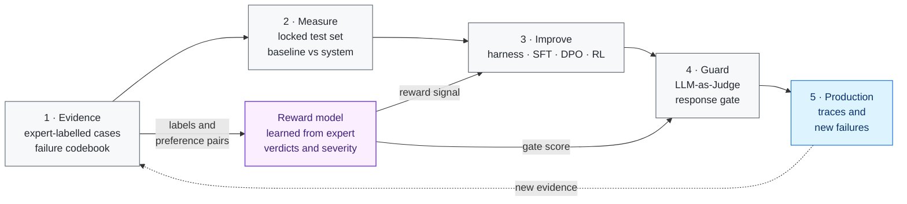
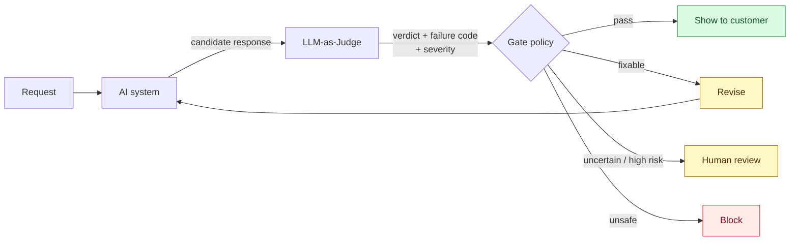
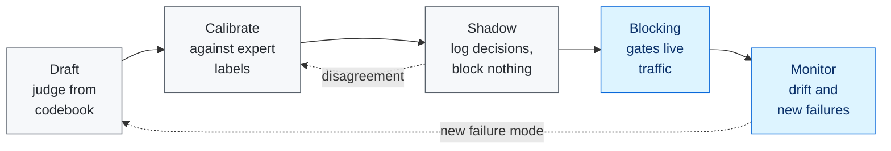

# GEDD: Grounded Evidence Driven Development

**GEDD turns domain-expert judgment into evidence your AI team can measure, train on and enforce.**

Most AI quality problems aren't model problems. They're definition problems: nobody has written down what "good" means for pharmacy, claims, tax, invoices or localization in a way a machine can check. Generic evaluators reward fluent, confident answers. Domain experts know which fluent answers are wrong.

GEDD puts those experts at the centre. They curate cases and judge real outputs. Product managers set the quality bar. ML engineers turn the result into three things:

| | What it is | Question it answers |
|---|---|---|
| **Measure** | A locked, held-out evaluation with a baseline score | Does our system beat the off-the-shelf model, and is the gain real? |
| **Improve** | Training and prompting signal taken from expert labels | What should the next version learn? |
| **Guard** | An LLM-as-Judge response gate calibrated on the same labels | Should this response reach the customer? |

All three come from the same evidence, and one component ties them together: a **reward model** learned from the experts' labels. That's what makes the gate explainable and the gains defensible.

## The GEDD flywheel



Offline, the loop proves a version is better before it ships. Online, the gate and production traces surface new failures, and those become the next round of evidence. Every turn of the wheel retrains the reward model on more expert judgment, so each turn makes both the system and its guard sharper.

### The reward model

The reward model is the expert's judgment, distilled into something that can score any response, instantly and at scale.

| | |
|---|---|
| **Learns from** | Expert verdicts (pass / fail), preference pairs ("A, not B, because `failure_code`") and severity weights from the codebook |
| **Outputs** | A score per response, plus the most likely failure code and severity |
| **In Improve** | The reward for RL, the ranker for best-of-N sampling, and a miner of DPO pairs from candidate outputs |
| **In Guard** | The score behind the response gate: allow, revise, human review or block |
| **In Production** | Scores every live trace so the lowest-scoring and most uncertain responses go to experts first |

It can be a prompted LLM-as-Judge to start, then a smaller trained classifier once there are enough labels. Either way, three rules keep it honest:

- **Calibrate it against experts.** Measure agreement with expert labels on a held-out slice (see [Cohen's kappa for LLM judges](grounded-evals/docs/cohens-kappa-for-llm-judges.md)) before it trains or gates anything.
- **Never let it grade the final exam.** The locked test set is always scored by the fixed scorer and expert labels, not by the reward model. Otherwise a policy can learn to please the reward model instead of the expert.
- **Watch for reward hacking.** When the reward model's score goes up but locked-set accuracy doesn't, send those responses to experts. Their verdicts become the next training round for the reward model.

---

## The five steps

```text
1. Create your evaluation    →  a real task, held-out cases, a success metric
2. Establish the baseline    →  score the off-the-shelf model(s) on those cases
3. Engineer your system      →  a harness, a fine-tune, or both
4. Rerun the same evaluation →  same cases, same scorer, same settings
5. Show the before & after   →  both scores, the gain, whether it's real, what it's worth
```

### 1 · Create your evaluation

| | |
|---|---|
| **Product manager** | Names the user and the job ("AP clerks key 10 fields off every invoice"), writes the business case and its assumptions, and picks a success metric the business recognises. |
| **Domain expert** | Curates realistic cases (happy path, edge cases, red flags), labels the right answer, and names the failure modes that matter. |
| **Artifacts** | Domain profile · curated cases · expert labels · failure codebook · **locked test set** |
| **Done when** | 100+ varied cases, split by group (customer, template, layout) so near-duplicates can't leak, and locked: never used for prompt design or training. |

### 2 · Establish the baseline

| | |
|---|---|
| **Product manager** | Decides which models count as "off-the-shelf" and approves the baseline cost. |
| **ML engineer** | Runs the same prompt on each model at temperature 0 and saves one result row per case, including its group. |
| **Done when** | Every baseline has a score, a cost and saved per-case outputs. |

Read the failures before moving on. They tell you whether the problem is reasoning (try a harness) or knowledge and conventions (try training).

### 3 · Engineer your system

| Option | What it is | GEDD evidence it uses |
|---|---|---|
| **Harness** | Wrap a model with retrieval, tools, checks or a better workflow and prompt | Codebook rules become instructions and checks; the judge becomes a response gate |
| **Fine-tune** *(optional)* | Train a model on task-specific examples | Expert corrections → SFT · "A, not B, because `failure_code`" → DPO pairs · failure severity → RL reward |
| **Combine** | Route between models, or put a fine-tuned model inside a harness | All of the above |

Start with the cheapest idea. Write down why you expect it to work, and keep the attempts that fail. They're evidence too.

### 4 · Rerun the same evaluation

Same cases, same scorer, same settings as Step 2. Nothing about the evaluation changes between before and after. Choose between candidate versions on a separate **dev split**, never on the locked test set.

### 5 · Show the before & after

- **Both scores and the gap**, on the same cases.
- **Is it real?** Call a gain real only if both tests agree:
  - **Exact McNemar test:** among cases where exactly one system is right, does yours win more often than chance? p < 0.05.
  - **Group bootstrap:** resample groups (customers, templates, layouts) 5,000 times; the 95% interval of the gain must exclude zero.
- **What it's worth:** the business metric (for documents, whole documents right, not just fields) and cost per case.
- **What didn't work**, and what it cost.
- **Where it might not hold:** report groups never seen in training separately.

---

## Worked example: invoice extraction

[`docile-forge/`](docile-forge/) runs all five steps on real scanned business documents from the DocILE benchmark (ICDAR 2023): read 10 key fields off each invoice and return JSON.


| Step | What was done | Result |
|---|---|---|
| 1 · Evaluation | 500 held-out documents = 5,000 field cases from 204 layouts; 124 documents on layouts never seen in training; normalised exact match; absent fields must be null | Locked before any work |
| 2 · Baseline | An open vision-language model (GLM 5.3 Flash), plain prompt, temperature 0 | **78.5%** of fields |
| 3 · Engineer | Harness A: labelling rules in the prompt · Harness B: rules + OCR text · Vision LoRA SFT on 1,400 training invoices | |
| 4 · Rerun | Same 5,000 cases, same scorer | Harness A 80.7% · Harness B 81.1% · **Fine-tune 88.4%** |
| 5 · Before & after | McNemar + layout-cluster bootstrap | **+9.8 points** (p = 1e-76, 95% CI [+7.7, +12.2]); **+4.7** on unseen layouts; fully correct invoices **12.8% → 38.8%** |

The write-up also reports what didn't work: the rules prompt fixed currency but made the model too eager to answer null.

**Next round:** expert review of the 582 remaining errors (real error, acceptable variant or label gap) feeds corrected labels, a second SFT round and DPO pairs. See [the roadmap](docile-forge/docs/roadmap-sft-dpo-gedd.md).

---

## What GEDD produces

| Artifact | What it answers | Used to |
|---|---|---|
| Domain profile | Who uses the system, and what risks matter? | scope |
| Curated cases + locked test set | Which scenarios must the system handle or reject? Which are never trained on? | measure |
| Baseline outputs | What does the current system actually do? | measure |
| Expert annotations | Is each response correct, partial, incorrect, unsafe or off-policy, and why? | measure · improve |
| Expert corrections | What should the response have been? | improve (SFT) |
| Failure codebook | Which failure modes recur, and how severe is each? | all three |
| Preference pairs | Which of two responses is better, and which failure code does the worse one carry? | improve (DPO) |
| Severity weights | How much does each failure cost the business? | improve (RL) |
| Calibration set | Which scenarios calibrate input checks, output checks and the response gate? | guard |
| Judge spec + prompt | What must the judge detect, block, escalate and explain? | guard |
| Measurement report | Is the gain real? Is the judge calibrated, traceable and covering the domain? | measure · guard |

### From evidence to training signal

The judgment that calibrates a judge is also the best training data you'll get.

| Expert evidence | Training signal | Technique | What it fixes |
|---|---|---|---|
| "This is the right answer" | Supervised target | SFT | Formats, conventions, house rules |
| "A is acceptable, B is not, because `failure_code`" | Chosen / rejected pair | DPO or ORPO | Choice errors: which number, which entity, answer vs abstain |
| "This failure is catastrophic, that one is minor" | Severity-weighted reward | RL with a verifiable reward | Business cost, not string match |
| "Allow / revise / review / block" | K-way labels | A small classifier judge | A cheap, calibrated gate on every response |
| "This label is wrong" | Corrected dataset | Fix data before training | Stops the model learning annotation mistakes |

**Rules for every round:**

- Never train or tune on the locked test set. Use a dev split grouped the same way.
- A new version counts only if it beats the previous one on the locked set with both McNemar and the group bootstrap.
- Report trade-offs by failure code. A round that cuts invented values by raising missed ones has to say so.
- Report the business metric, not only the proxy.

---

## Who does what

GEDD is one workflow seen from three seats.

| Step | Domain expert | Product manager | ML engineer |
|---|---|---|---|
| Scope | Names real risks and red flags | Defines the product boundary and success metric | Advises on what's measurable |
| Cases | Curates and labels scenarios | Prioritises by customer impact | Builds the locked test set and dev split |
| Review | Judges baseline outputs and names failure codes | Sets severity and what blocks launch | Exports annotations into datasets |
| Improve | Writes corrections and ranks pairs | Approves the training budget | Trains the next version and proves the gain |
| Guard | Approves gate behaviour per failure | Owns the release decision | Builds, calibrates and deploys the judge |
| Operate | Reviews new failures | Tracks risk and drift | Monitors and feeds traces back |

### For the domain expert

You don't write code or tune prompts. You say what a good answer looks like, what a dangerous one looks like, and when the system must slow down or escalate.

1. **Define the domain.** *What can go wrong if the system answers badly?* A pharmacist might name dose-unit confusion; a claims specialist, invented coverage status; a localization lead, broken runtime placeholders.
2. **Curate scenarios** that cover the domain, not a random prompt list: happy path, edge case, adversarial, ambiguous, multi-turn, error recovery, persona or permission variation, domain red flag.
3. **Review real outputs** and label each one correct, partial, incorrect or needs human review. The reason matters most: what do you see that a generic evaluator would miss?
4. **Name the failure** with a stable code, such as `dose_unit_confusion`, `coverage_hallucination` or `placeholder_and_markup_corruption`. The judge uses these codes as labels.
5. **Approve the gate behaviour** for each failure: allow, revise, show resources, block or escalate.

Your judgment becomes executable quality control and the curriculum the next model learns from.

### For the product manager

GEDD turns "is the AI good enough?" into a decision you can defend: *which customer-visible responses are allowed, revised, escalated or blocked?*

| Your question | GEDD evidence |
|---|---|
| What can go wrong? | Domain risks, red-flag scenarios, failure codebook |
| How often does it go wrong? | Baseline annotations on the locked set |
| What blocks launch? | Severity and gate policy |
| Are we testing the right things? | Category coverage and saturation |
| Can we explain the gate? | Trace from scenario → annotation → failure code → judge criterion |
| Is the judge ready to block traffic? | Judge-human agreement, false-positive and false-negative checks |
| Did the new version really improve? | Locked-set gap with McNemar p and group bootstrap interval |
| Where do we invest next? | Remaining errors by failure code and severity |

You don't argue from opinion. You point to a scenario, an annotation, a failure code and a gate decision.

### For the ML engineer

You can't automate "make it more compliant". GEDD gives you structured, traceable data instead: annotation → failure code → severity → expected action → calibration case. From that you build SFT sets, preference pairs, reward weights, judge prompts, regression tests, CI checks, shadow monitors and the response gate.

---

## The response gate

The judge sits between the system and the customer. It returns a structured decision; a policy layer acts on it.



A typical judge output contract:

```json
{
  "pass_fail": "pass | fail",
  "failure_code": "codebook label or null",
  "severity": "low | medium | high | critical | catastrophic",
  "rationale": "why the response passes or fails",
  "evidence_references": ["case id", "failure code", "judge criterion"],
  "recommended_action": "allow | revise_response | request_human_review | block",
  "customer_visible_block": true
}
```

Enforce schema validity, exact codebook labels and routing behaviour in tests.

### Promoting the gate

A judge doesn't block production traffic on day one.



| Move to | Only when |
|---|---|
| Shadow | Judge-human agreement meets the target on labelled cases (see [Cohen's kappa for LLM judges](grounded-evals/docs/cohens-kappa-for-llm-judges.md)) |
| Blocking | False positives on clean cases and false negatives on critical failures are within limits; output is always schema-valid |
| Back to draft | Monitoring finds a failure mode the codebook doesn't cover |

---

## A concrete example

A game localization assistant is asked to review a translated subtitle. The translation reads naturally but has dropped the `{player_name}` placeholder. A generic evaluator approves it. A localization expert doesn't.

| Evidence field | Value |
|---|---|
| Scenario | Localized subtitle drops `{player_name}` but reads naturally |
| System answer | "Acceptable; the meaning is preserved" |
| Expert verdict | Incorrect |
| Failure code | `placeholder_and_markup_corruption` |
| Severity | Catastrophic |
| Reason | Runtime variables are required; losing one can break the UI or dialogue state |
| Gate action | Block approval until the placeholder is restored and tested in context |

The judge no longer asks "is this translation fluent?" It asks "does this response approve a defect that the evidence says must be blocked?"

## Why not just write a rubric?

| | Generic rubric | GEDD |
|---|---|---|
| Starts from | Criteria written up front ("be accurate") | Observed behaviour on real cases |
| Failure categories | Assumed | Discovered by experts, with stable codes |
| Catches fluent but wrong answers | Rarely | By design |
| Traceability | Criterion → score | Case → annotation → code → criterion → decision |
| Feeds training | No | Corrections, pairs and severity weights |
| Proves improvement | Not on its own | Locked set + significance tests |

## What good looks like

- A domain profile with explicit users, risks, boundaries and known edge cases
- Scenarios covering happy paths, edge cases, adversarial pressure, ambiguity, multi-turn context, recovery, persona variation and red flags
- A locked test set and a dev split, grouped so near-duplicates can't leak
- Expert annotations with severity and rationale, and a codebook with exact labels
- A baseline score, a system score, and a significance report for every version
- Training data derived from the evidence: corrections, preference pairs, severity weights
- A judge with structured output, traceable to evidence, measured for agreement and error rates
- A gate that runs in shadow before it blocks, and a path for new failures back into the evidence

## Get started

- **Run the app:** [SETUP.md](SETUP.md) — install, configure a model provider, run locally or deploy.
- **Method in depth:** [METHODOLOGY.md](METHODOLOGY.md) — the grounded-theory coding behind case curation and error analysis.
- **Research positioning:** [RESEARCH.md](RESEARCH.md) — how GEDD compares with the post-training literature (RLHF, DPO, reward models, rubric rewards), its gaps, and the experiments that would test its central claim.
- **Guides:** [domain expert guide](grounded-evals/docs/domain-expert-guide.md) · [pipeline guide](grounded-evals/docs/pipeline-guide.md) · [building an LLM-as-Judge](grounded-evals/docs/building-llm-as-a-judge.md) · [launch checklist](grounded-evals/docs/launch-checklist.md)
- **Worked example:** [docile-forge/](docile-forge/)

## In one sentence

> GEDD is the evidence pipeline that turns expert judgment into a system that keeps getting better, and the proof that it did.
