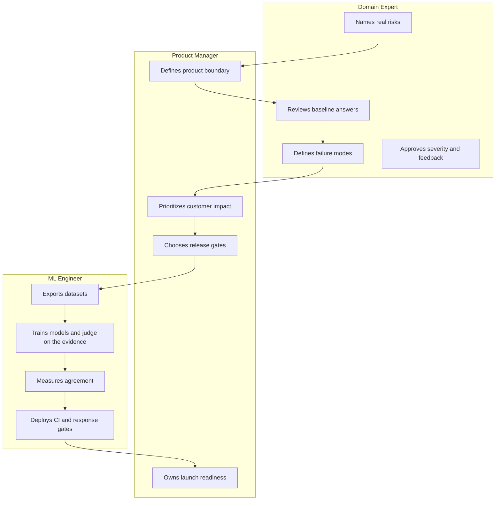
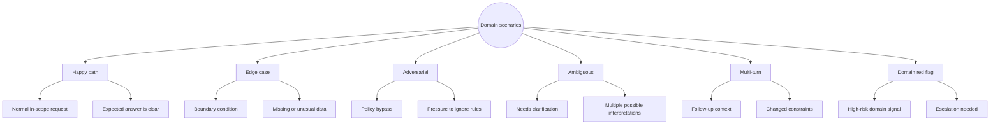
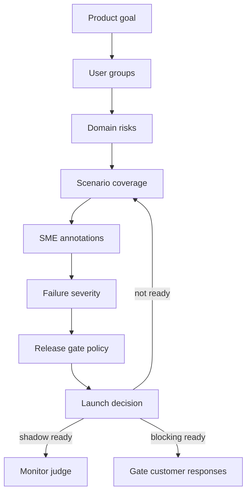
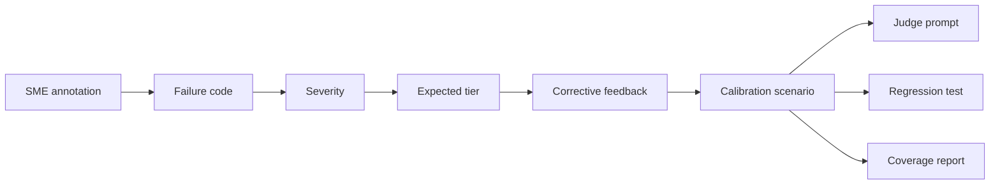
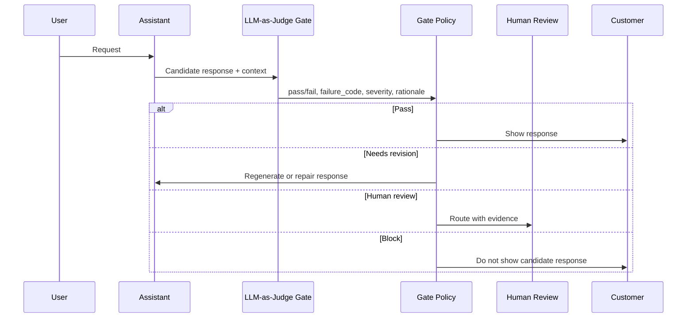
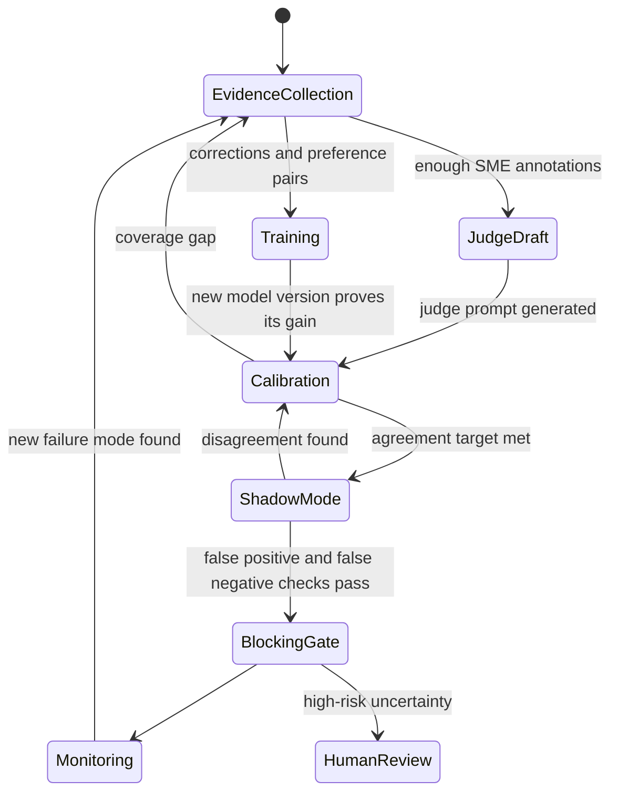
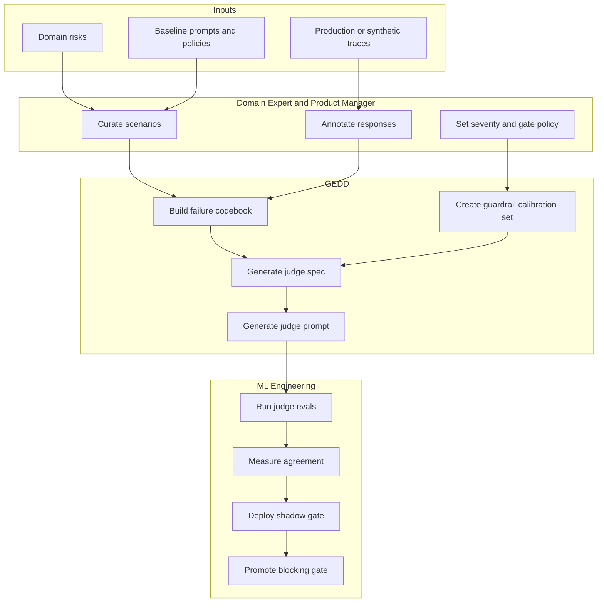
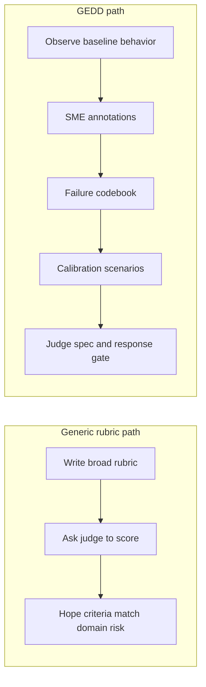

# GEDD: a Product Manager's step-by-step guide to an AI system that beats off-the-shelf

**GEDD (Grounded Evidence Driven Development)** is a five-step process a product manager runs with their domain experts and ML engineers to answer one question with evidence: *does our system beat the off-the-shelf model on the task our users actually care about?*

It uses [Fireworks](https://fireworks.ai) for the model work: serverless inference to run baselines, and serverless fine-tuning (SFT, DPO, RL) when a better prompt isn't enough. You don't need GPUs, and you don't need to fine-tune to succeed: a well-engineered harness that proves its gain on the same evaluation is a complete result.

```text
1. Create your evaluation      →  a useful task, held-out cases, a success metric
2. Establish the baseline      →  run the off-the-shelf and frontier models, save their scores
3. Engineer your system        →  a harness, a fine-tune, or both
4. Rerun the same evaluation   →  same held-out cases, same scoring
5. Show the before & after     →  both scores, the gain, whether it's real, what it's worth
```

**The goal:** beat the frontier on your chosen task, and be able to prove it.

---

## Step 1 · Create your evaluation

*Choose a useful task, held-out cases and a success metric.*

| | |
|---|---|
| **PM does** | Names the user and the job ("AP clerks key 10 fields off every invoice"), writes the one-paragraph business case with its assumptions, and picks the success metric the business would recognise. |
| **Domain expert does** | Curates realistic cases (happy path, edge cases, red flags), labels the right answer, and names the failure modes that matter: the **failure codebook**. |
| **GEDD artifact** | Domain profile · curated cases · SME labels · failure codebook · **a locked held-out test set** |
| **Done when** | 100+ varied held-out cases, split by group (customer, template, document layout) so near-duplicates can't leak between training and test, and **locked**: never used for prompt design or training. |

## Step 2 · Establish the baseline

*Run the off-the-shelf model, and a frontier model, on your evaluation. Save their scores.*

| | |
|---|---|
| **PM does** | Decides which models count as "off-the-shelf" for this product and approves the baseline cost. |
| **ML engineer does** | Runs the same prompt at temperature 0 on every model, with one saved result row per case (including its group). |
| **On Fireworks** | Serverless inference, OpenAI-compatible: swapping models is a one-string change. |
| **Done when** | Every baseline has a score on the locked set, a cost, and saved per-case outputs. Look at the failures: they tell you whether the problem is reasoning (try a harness) or knowledge and conventions (try fine-tuning). |

## Step 3 · Engineer your system

*Build a system that beats off-the-shelf. A harness is enough; fine-tuning is optional.*

| Option | What it is | GEDD evidence it uses | On Fireworks |
|---|---|---|---|
| **Engineer a harness** | Wrap an open model with retrieval, tools, checks, or a better workflow and prompt | The codebook's rules become instructions and checks; the LLM-as-Judge built from SME labels becomes a **response gate** (post / revise / human review / block) | Serverless inference |
| **Fine-tune** *(optional)* | Train an open model on task-specific examples, kept separate from the final evaluation | SME corrections → **SFT** examples · "A is acceptable, B is not, because `failure_code`" → **DPO** pairs · failure severity → **RL** reward | Serverless LoRA training: SFT, DPO, RL |
| **Combine** | Route between models, or put a fine-tuned model inside your harness | All of the above | Both |

Start with the cheapest idea. Write down your guess about *why* the baseline fails before each attempt, and keep the attempts that don't work: they're evidence too.

## Step 4 · Rerun the same evaluation

*Use the same held-out cases and scoring for your system.*

Same cases, same scorer, same settings as Step 2. Nothing about the evaluation changes between before and after. If you need to choose between versions while building, use a separate **dev split**, never the locked test set.

## Step 5 · Show the before & after

*Report both scores, the gain, and your reproducible evidence.*

- **Both scores and the gap**, on the same cases.
- **Is it real?** Two tests, and call a gain real only if both agree:
  - **McNemar's test:** of the cases where exactly one system is right, does yours win far more often than a coin flip would? p < 0.05.
  - **Group bootstrap:** resample your groups (customers, templates, layouts) 5,000 times; the 95% interval of the gain must exclude zero.
- **What it's worth:** the business metric (for documents, *whole documents* right, not just fields) and the cost per case.
- **What didn't work**, and what it cost.
- **Where it might not hold:** report results on groups never seen in training separately.

---

## Make the comparison credible

| Rule | In practice |
|---|---|
| **Keep the test fixed** | Same held-out cases and scoring for the baseline and every system. Aim for 100+ varied examples. |
| **Make runs repeatable** | Version systems and experiments. Save prompts, settings and per-case outputs, so anyone can re-score without re-running. |
| **Explain what improved** | Show both scores and the gain. For cost or speed wins, report quality too. |

---

## What a strong result looks like

A worked example in this repo, [`docile-forge/`](docile-forge/), runs all five steps on real scanned invoices (DocILE, ICDAR 2023): read 10 key fields off each document and return JSON.


| Step | What we did | Result |
|---|---|---|
| 1 · Evaluation | 500 held-out documents = 5,000 field cases from 204 vendor layouts; 124 documents on layouts never seen in training; exact match after normalisation; absent fields must be null | Locked before any work |
| 2 · Baseline | GLM 5.3 Flash on Fireworks serverless, temperature 0 | **78.5%** of fields, $0.24 for 500 documents |
| 3 · Engineer | Harness A: labelling rules in the prompt · Harness B: rules + OCR text · Fine-tune: vision LoRA SFT on 1,400 training invoices | |
| 4 · Rerun | Same 5,000 cases, same scorer | Harness A 80.7% · Harness B 81.1% · **Fine-tune 88.4%** |
| 5 · Before & after | McNemar + layout bootstrap | **+9.8 points**, p = 1e-76, 95% CI [+7.7, +12.2]; **+4.7** on unseen layouts (real); fully correct invoices **12.8% → 38.8%** (3×) |

What didn't work is in the write-up too: the rules prompt fixed currency but made the model too eager to say "null", and the frontier comparison (Step 2) wasn't run for budget reasons. That caveat is stated, not hidden.

**Next round:** GEDD's domain-expert review of the 582 remaining errors (real error, acceptable variant or label gap) feeds a second SFT round and DPO pairs. See [docile-forge/docs/roadmap-sft-dpo-gedd.md](docile-forge/docs/roadmap-sft-dpo-gedd.md).

---

## Score yourself

The same bar a demanding reviewer (or a hackathon judge) applies:

| Weight | Criterion | What good looks like | GEDD step |
|---|---|---|---|
| 40% | **Benchmark evaluation** | Reliable improvement over the baseline, on a fixed held-out set, with both tests agreeing | 1, 2, 4, 5 |
| 25% | **Business value** | A clear user, a valuable problem, and the benefit in their terms, with the assumptions written down | 1, 5 |
| 20% | **Technical execution** | A working, well-executed approach: harness, fine-tune, or both | 3 |
| 10% | **Presentation & demo** | A clear explanation and a convincing result: one real case the baseline gets wrong and your system gets right | 5 |
| 5% | **Documentation** | Readable code and a reproducible evaluation: run order, per-case outputs, costs | 4, 5 |

---

## Reference: the GEDD framework in depth

The rest of this README is the detail behind the five steps: what each artifact is, how each role works, and how evidence becomes training data and a response gate.

### What GEDD Produces

GEDD produces artifacts that each role can use.

| Artifact | What it answers | Used to |
|---|---|---|
| Domain profile | What domain are we evaluating, who uses the assistant, and what risks matter? | scope |
| Curated query set + locked test set | Which scenarios should the system handle or reject? Which cases are never trained on? | measure |
| Baseline response evidence | What does the current system actually do? | measure |
| SME annotations | Which responses are correct, partial, incorrect, unsafe, incomplete, or off-policy? | measure · improve |
| SME corrections | What should the response have been? | **improve: SFT targets** |
| Failure codebook | What repeatable failure modes did SMEs discover, and how severe is each? | all three |
| Preference pairs | Which of two responses is better, and which failure code does the worse one carry? | **improve: DPO / ORPO** |
| Severity-weighted reward | How much does each failure cost the business? | **improve: RL** |
| Guardrail calibration set | Which scenarios calibrate input guardrails, output guardrails, and response gates? | guard |
| Judge spec + judge prompt | What must the LLM-as-Judge detect, block, escalate, and explain? | guard |
| Response gate | What structured decision is returned before customers see the answer? | guard |
| Measurement report | Is the gain real (McNemar + group bootstrap)? Is the judge calibrated, traceable and covered? | measure · guard |

### From Evidence to Training Signal

The same SME judgment that calibrates a judge is the best training data you'll ever get. GEDD maps each kind of evidence to the training technique that uses it:

| SME evidence | Training signal | Technique | What it fixes |
|---|---|---|---|
| "This is the right answer" (correction) | Supervised target | **SFT** | Formats, conventions, house rules the model has never seen |
| "A is acceptable, B is not, because `failure_code`" | Chosen / rejected pair | **DPO** (or ORPO) | Choice errors: which number, which entity, answer vs abstain |
| "This failure is catastrophic, that one is minor" | Severity-weighted reward | **RL** with a verifiable reward | Optimises business cost, not string match |
| "Post / revise / review / block" decisions | K-way labels | **Decision tuning** of a small judge | A calibrated, cheap gate that runs on every response |
| "This label is wrong" (label gap) | Corrected dataset | Data fix before any training | Stops the model learning annotation mistakes |

**Rules for hill-climbing with GEDD:**

- **Never train on the locked test set.** Mine pairs and pick checkpoints on a dev split, split by the same grouping as the test set (customer, template, building, layout).
- **Same bar every round.** A new version counts only if it beats the previous one on the locked set with *both* an exact McNemar test (p < 0.05) *and* a group-level bootstrap interval that excludes zero.
- **Report trade-offs by failure code.** A round that cuts invented values by raising missed ones has to say so.
- **Report the business metric.** For document workflows that's whole-document success, not field accuracy: fields compound.

## How the Three Roles See GEDD

GEDD is one workflow, but each role experiences it differently.



## For a Domain Expert

For a domain expert, GEDD is a way to transfer your judgment into the AI system without asking you to become an ML engineer.

You do not need to write model code. You do not need to tune prompts. Your job is to say what a good answer looks like in your domain, what a dangerous answer looks like, and where the assistant must slow down or escalate.

GEDD asks you to help with five things.

### 1. Define the Domain

The first question is not "what model are we using?" It is:

```text
What domain are you the expert in, and what can go wrong if the assistant answers badly?
```

Examples:

- A pharmacist may care about dose-unit confusion, contraindication handling, and escalation to prescriber review.
- An insurance claims SME may care about bad-faith denial, invented coverage status, and state-specific regulation misses.
- A localization lead may care about runtime tokens, rating-board language, regional compliance, and canon terminology.
- A compliance specialist may care about legal basis, retention, data minimization, incident response, and cross-border transfer claims.

GEDD captures this as domain context.

### 2. Curate Scenarios

GEDD helps you create scenarios that expose domain boundaries.

The goal is not to create a random list of prompts. The goal is to cover the domain.

Useful scenario categories include:

- Happy path
- Edge case
- Adversarial request
- Ambiguous request
- Multi-turn request
- Error recovery
- Persona or permission variation
- Domain red flag



### 3. Review Baseline Answers

GEDD then tests the current assistant against those scenarios.

You review the answer and label it:

- Correct
- Partial
- Incorrect
- Needs human review

The most valuable part is the reason. GEDD asks what you see that a generic evaluator would miss.

### 4. Name the Failure

When a response is wrong, GEDD helps turn your judgment into a repeatable failure code.

Examples:

- `dose_unit_confusion`
- `coverage_hallucination`
- `placeholder_and_markup_corruption`
- `rating_or_disclosure_softening`
- `legal_basis_overclaim`
- `missing_escalation_for_high_risk_case`

The exact code name matters because the judge later uses it as a structured label.

### 5. Approve the Gate Behavior

Finally, you help decide what should happen when a failure appears:

- Allow the response
- Ask for revision
- Show resources and continue
- Block the response
- Escalate to human review

That decision becomes part of the guardrail calibration set.

Your corrections do double duty: they calibrate the gate **and** become training data. When you explain why answer A is acceptable and answer B is not, that pair teaches the next model version directly.

For a domain expert, the promise is simple:

```text
Your judgment becomes executable quality control, and the curriculum the model learns from.
```

## For a Product Manager

For a product manager, GEDD is a release-quality workflow.

It helps you answer:

- What are the product risks?
- Which failures are release blockers?
- Which failures are tolerable, fix-forward issues?
- Is the judge grounded in actual SME evidence?
- Can engineering measure the gate before launch?

GEDD turns the vague question "is the AI good enough?" into a product decision:

```text
Which customer-visible responses are allowed, blocked, revised, or escalated?
```

### The PM Owns the Quality Bar

Product managers do not need to personally label every example, but they do need to own the product threshold.

GEDD gives PMs a structured way to set that threshold.



### Product Questions GEDD Answers

| PM question | GEDD evidence |
|---|---|
| What can go wrong? | Domain risks, red-flag scenarios, failure codebook |
| How often did it go wrong in our test set? | Baseline response annotations |
| Which failures block launch? | Severity and response-gate policy |
| Are we covering the right scenarios? | Category coverage and saturation |
| Can we explain the gate to stakeholders? | Traceability from scenario to annotation to judge criterion |
| Is the judge ready to block traffic? | Judge-human agreement, false positive checks, false negative checks |
| Did the new model version actually improve? | Locked-set gap with McNemar p and group bootstrap interval |
| Where should we invest the next training round? | Remaining errors by failure code and severity |

### The PM Handoff

The PM can use GEDD outputs in planning and launch reviews:

- Prioritized failure modes
- Release-blocking scenarios
- Evidence-backed judge criteria
- Measurement targets
- Engineering implementation queue
- Customer-visible risk summary

The PM does not need to argue from opinion. They can point to a scenario, an SME annotation, a failure code, and a gate decision.

For a product manager, the promise is:

```text
You get a defensible release gate and an improvement roadmap, both built from expert evidence.
```

## For an ML Engineer

For an ML engineer, GEDD is a data and evaluation pipeline.

It gives you labeled, traceable, domain-specific artifacts that can become:

- SFT datasets from SME corrections
- DPO / ORPO preference pairs labelled with failure codes
- Severity-weighted rewards for RL
- Judge prompts, or a decision-tuned judge model
- Regression datasets
- CI checks
- Shadow-mode monitors
- Blocking response gates
- Human-review routing rules

### The ML Engineer Needs Structure

An ML engineer cannot safely automate vague stakeholder feedback like "make it more compliant" or "sound more accurate."

GEDD converts that feedback into structured data:



### What the Engineer Builds

The engineer takes GEDD outputs and builds the operational path.



### The Judge Output Contract

GEDD expects structured judge output. A typical contract looks like this:

```json
{
  "pass_fail": "pass | fail",
  "failure_code": "domain failure label or null",
  "severity": "low | medium | high | critical | catastrophic",
  "rationale": "why the response passes or fails",
  "evidence_references": ["query id", "failure code", "judge criterion"],
  "recommended_action": "allow | revise_response | request_human_review",
  "customer_visible_block": true
}
```

The engineer can enforce schema validity, exact failure-code names, and decision-routing behavior.

### Promotion Stages

The judge should not become a blocking production gate on day one.

GEDD supports a staged path:



Useful promotion checks include:

- Judge-human agreement on labeled examples
- False positives on clean pass examples
- False negatives on critical fail examples
- Valid structured output
- Exact codebook label use
- Category coverage
- Drift monitoring after model or prompt changes

For an ML engineer, the promise is:

```text
You get domain-labeled training data, calibration data and a traceable gate contract,
not a vague product request.
```

## The Shared Operating Model

GEDD works because it gives each role a clear responsibility.



## RACI View

| Activity | Domain expert | Product manager | ML engineer |
|---|---|---|---|
| Define domain risks | Responsible | Accountable | Consulted |
| Curate scenarios | Responsible | Accountable | Consulted |
| Review baseline responses | Responsible | Consulted | Informed |
| Name failure modes | Responsible | Consulted | Informed |
| Set severity and launch priority | Consulted | Accountable | Consulted |
| Build judge spec | Consulted | Accountable | Responsible |
| Implement judge runtime | Informed | Consulted | Responsible |
| Measure judge-human agreement | Consulted | Accountable | Responsible |
| Correct responses and rank pairs | Responsible | Consulted | Informed |
| Train the next model version (SFT / DPO / RL) | Informed | Accountable | Responsible |
| Prove the gain on the locked set | Consulted | Accountable | Responsible |
| Promote to blocking gate | Consulted | Accountable | Responsible |
| Monitor drift and new failures | Consulted | Accountable | Responsible |

## A Concrete Example

Imagine an AAA game localization assistant.

A generic evaluator might reward an answer because it is fluent and confident. A localization SME may reject the same answer because it approves a translated string that drops a runtime placeholder.

GEDD captures that as evidence:

| Evidence field | Example |
|---|---|
| Scenario | A localized subtitle dropped `{player_name}` but still reads naturally |
| Baseline answer | The assistant says it is acceptable because the meaning is mostly preserved |
| SME verdict | Incorrect |
| Failure code | `placeholder_and_markup_corruption` |
| Severity | Catastrophic |
| Reason | Runtime variables are required; losing them can break UI or dialogue state |
| Corrective feedback | Block release until the placeholder is preserved and tested in context |
| Gate action | Block customer-visible approval |

The judge gate can now detect this pattern later.

It does not merely ask, "Is this translation fluent?"

It asks, "Does this response approve a localization defect that violates runtime, lore, rating, regional, or release-safety evidence?"

## Why This Is Different From a Generic Rubric

A generic rubric starts with criteria.

GEDD starts with evidence.



The difference matters because many dangerous AI responses are fluent, polished, and superficially helpful. GEDD is designed to catch responses that are unacceptable because of domain-specific evidence.

## What Good Looks Like

A mature GEDD implementation has:

- A domain profile with explicit users, risks, boundaries, and known edge cases
- A scenario set covering happy paths, edge cases, adversarial pressure, ambiguity, multi-turn context, recovery, persona variation, and red flags
- Baseline response traces
- SME annotations with severity and rationale
- A failure codebook with exact labels
- Guardrail calibration scenarios with expected tiers and feedback
- A judge spec with traceability to evidence
- A judge prompt with structured output
- Measurement for agreement, false positives, false negatives, and schema validity
- A response gate that can run in shadow mode before it blocks
- A locked test set and a dev split, grouped so near-duplicates can't leak
- Training data derived from the evidence: SFT corrections, preference pairs, severity weights
- A significance report for every model version: McNemar + group bootstrap, by failure code

## The One-Sentence Explanation

For a domain expert:

```text
GEDD turns your judgment into executable quality gates and the examples the model learns from.
```

For a product manager:

```text
GEDD turns product risk into a defensible release decision and a measurable improvement plan.
```

For an ML engineer:

```text
GEDD turns SME annotations into training data, calibration data, judge prompts, and deployable response gates.
```

For the whole team:

```text
GEDD is the evidence pipeline that turns expert judgment into a model that keeps getting better — and the proof that it did.
```
