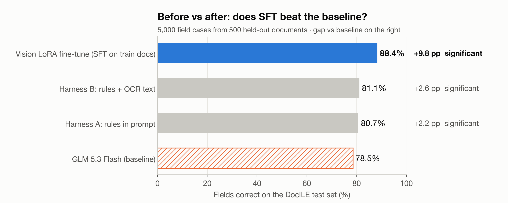
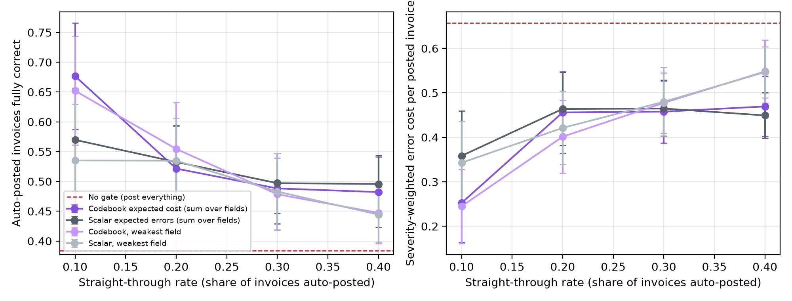
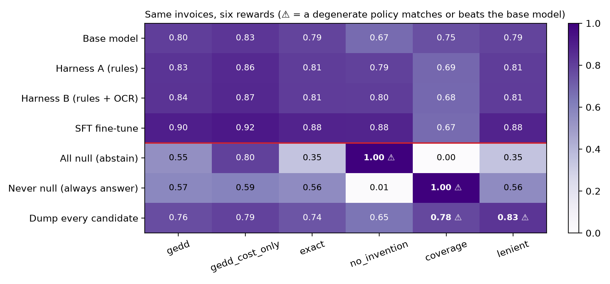
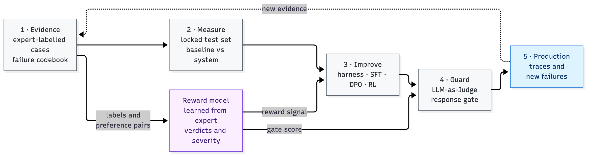
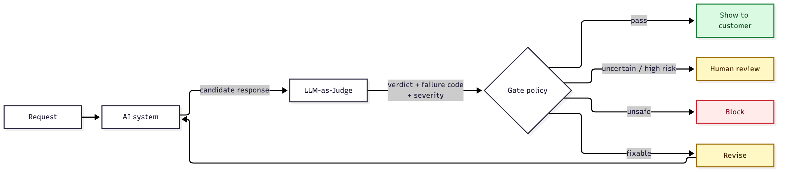
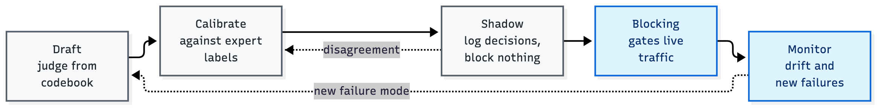

# GEDD: Grounded Evidence Driven Development

**GEDD keeps your AI product's taste as you build with agents.** Your domain experts name and rank the ways your product must never fail. GEDD turns that one list into your eval, your RL reward and your response gate, so every model upgrade, prompt change and training run is held to your standard, not a generic one.

---

## Why GEDD

**Your product's taste is its moat, and it erodes silently.** Taste is what your domain experts know good and unacceptable look like for *your* product: a subtitle that drops `{player_name}`, an invoice total taken before commission, a dose given in the wrong unit. A competitor can use the same base model and the same agent framework. They can't copy that judgment.

Every model swap, prompt change, agent-framework change, fine-tune and RL run is optimised against *something*. When that something is generic (a generic LLM judge, a proxy reward, a public benchmark, "be accurate"), the product drifts toward generic model behaviour, and aggregate scores hide it. In our own invoice study, prompting traded invented values for missed ones while the headline score barely moved (F4), and every proxy reward we audited paid a degenerate policy (F8). The score went up; the product got worse in ways users would notice.

GEDD makes taste the thing you measure, train and ship against:

| | What happens | What you get |
|---|---|---|
| **Make it explicit** | Experts label real outputs and name each failure, with a severity and whether it blocks. That list is the **failure codebook** | Your standard, written down and owned by the people who know it |
| **Measure it** | A locked eval, reported by failure code, with significance tests | Proof a change kept the taste, not just a higher average |
| **Train toward it** | The codebook becomes the RL reward: rule-based where answers are checkable, an LLM-as-Judge reward model where they aren't | Training that climbs your standard instead of a proxy |
| **Enforce it** | A response gate: allow / revise / human review / block | Taste held in production, one response at a time |
| **Guard it** | Reward audits before training, a reward-hacking tripwire during it, expert sampling + PPI++ on live traffic | You notice the moment a change starts trading taste away |
| **Grow it** | New failures from production feed the next round | A moat that compounds: evidence competitors don't have |

Under the hood, GEDD is an **RL eval harness grounded in expert evidence**: environments, rewards, reward audits, a trainer-agnostic harness and the statistics to tell a real gain from noise.

---

## Evidence so far

*Updated 2026-11-04. Every number below is regenerated from saved per-case results, and CI fails if they drift. Null results are reported alongside the wins. The full log, with ids, evidence and scripts, is in [FINDINGS.md](FINDINGS.md).*

### ✅ Proven: a GEDD round raises the product's standard on real invoices, not just the average

On 500 held-out scanned invoices from DocILE (5,000 field cases across 204 layouts), a vision LoRA fine-tune of an open model raised field accuracy from **78.5% to 88.4%**. Invoices with all 10 fields right **tripled, from 12.8% to 38.8%**. Total compute was under $50.



| Comparison | Gap (pts) | p (Holm-adjusted, 7 tests) | Layout-cluster 95% CI | Real? |
|---|---|---|---|---|
| Fine-tune vs base model | **+9.8** | 1e-75 | [+7.7, +12.2] | ✅ |
| Fine-tune vs base, layouts never seen in training | **+4.7** | 9e-6 | [+1.8, +8.1] | ✅ |
| Fine-tune vs best prompt (rules + OCR) | +7.2 | 3e-47 | [+5.7, +9.0] | ✅ |
| Best prompt vs base, unseen layouts | +0.2 | 1.0 | [−3.1, +3.6] | ❌ underpowered (can only detect ≥ 4.9) |
| Rules prompt vs base, whole invoices right | +4.0 | 0.01 (unadjusted) | [−0.4, +8.6] | ❌ passes McNemar, fails the cluster bootstrap |

**What the failure codes show (and the average hides):** the fine-tune cut invented values by 62% and wrong values by 39%, but missed values *rose* 22%. Prompting traded invented values for missed ones. The aggregate score hides both trade-offs. → F1–F5 · [`08_rigor.py`](experiments/docile-invoices/08_rigor.py)

### ⚠️ Pilot, null result: decomposing the reward helps only when the detectors are good

We tested the codebook reward model (per failure code, weighted by severity, calibrated) against a single scalar reward. The gate auto-posts invoices at matched straight-through rates, and the only evidence is whether other systems agree with the answer, so no gold labels are used.

- The detectors are **calibrated** (ECE ≤ 0.02) but **weak** (AUROC 0.55 for invented values, 0.73 for wrong values, 0.83 for missed values).
- At the strictest gate (10% of invoices auto-posted), the codebook reward posts **about 11 points more fully correct invoices** in 90% of 50 splits. The 95% range still crosses zero, and at looser gates there's no difference.
- **Takeaway:** the codebook form is necessary but not sufficient. The gain scales with detector quality, which is what experiment E2 tests with real LLM judges.



→ F6 · [`09_reward_gate_ppi.py`](experiments/docile-invoices/09_reward_gate_ppi.py)

### ⚠️ Pilot: online estimates stay valid, but a weak judge saves few expert labels

Prediction-powered inference (PPI++) combines judge scores on every case with a small random expert sample. Its 95% intervals had close to nominal coverage (92–97%) for field accuracy and invoice success. With the weak judge above, they were only **1–6% narrower** than expert labels alone. PPI++ falls back to the experts instead of inheriting the judge's bias, which is the safe behaviour. → F7

### ✅ Proven before any training: a reward audit catches the rewards that would trade taste away

Every candidate reward was scored on the same 500 invoices, for the real systems and for three degenerate policies: answer null everywhere, never answer null, and dump every candidate into each field.
- **All three proxy rewards pay a degenerate policy.** Charging only for invented values pays abstention a perfect 1.0, above the fine-tune.
- **The GEDD reward and the exact scorer pay none of them.**
- **A GEDD reward that only charges severity leaves abstention within 0.03 of the base model.** Paying +1 per correct field widens the gap to 0.26. Pay for the goal, charge for the cost.



→ F8 · [`12_reward_audit.py`](experiments/docile-invoices/12_reward_audit.py) · RL environment: [`rl_env.py`](experiments/docile-invoices/rl_env.py) · harness: [`rl_harness.py`](experiments/docile-invoices/rl_harness.py) · judge as reward: [docs/judge-reward-rl.md](docs/judge-reward-rl.md)

### ⏳ Next: pre-registered experiments

| | Question | Status |
|---|---|---|
| **E1** | Where should criteria come from: a generic judge, an expert rubric written up front, an LLM-written rubric, or the GEDD codebook, at the same expert budget? | Needs experts and a second domain |
| **E2** | Codebook vs scalar LLM-judge reward under best-of-N pressure: which overoptimizes less? | Script ready, about $12 → [`10_bon_overopt.py`](experiments/docile-invoices/10_bon_overopt.py) |
| **E3** | How much accuracy does each expert label buy, and does the online loop improve the model round after round? | Planned |
| **Labels** | Two experts double-label the 582 remaining errors; inter-annotator agreement; re-scoring under corrected labels | Kit ready → [`11_expert_kit.py`](experiments/docile-invoices/11_expert_kit.py) |
| **R1** | GRPO under the GEDD reward vs two hackable proxies: does RL amplify the loophole the audit predicts? | Environment + harness ready; plug in any GRPO trainer → [`rl_harness.py`](experiments/docile-invoices/rl_harness.py) |

Full positioning against the post-training literature, the gap list and its status: [docs/research.md](docs/research.md).

---

## Where to go

| I want to… | Go to |
|---|---|
| Understand GEDD in five minutes | [Why GEDD](#why-gedd) and [the flywheel](#the-gedd-flywheel) |
| See every finding with its evidence and status | [FINDINGS.md](FINDINGS.md) |
| Reproduce the findings | [`experiments/docile-invoices/`](experiments/docile-invoices/): `uv sync`, then `uv run python 08_rigor.py` and `uv run python 09_reward_gate_ppi.py` (no API key needed) |
| Test whether my own system's gain is real | [`grounded-evals stats compare`](#tooling) |
| Score and gate responses with a codebook | [`grounded-evals reward score`](#tooling) |
| Run the expert-facing app (curate cases, annotate, build a judge) | [docs/setup.md](docs/setup.md) · [domain expert guide](docs/guides/domain-expert-guide.md) |
| Find docs by flywheel stage or by role | [docs/](docs/) |
| Improve my agent app's taste with RL, round after round | [The RL eval flywheel](docs/guides/rl-eval-flywheel.md) · `grounded-evals flywheel demo` |
| Train an agent against my own standard | [RL eval harness](experiments/docile-invoices/README.md#rl-eval-harness) · [LLM-as-Judge as the reward](docs/judge-reward-rl.md) |
| See how GEDD compares with RLHF, DPO and rubric rewards | [docs/research.md](docs/research.md) |
| Learn the qualitative method behind the codebook | [docs/methodology.md](docs/methodology.md) |

---

## The GEDD flywheel

<p align="center"></p>

<sub>Diagram source: <a href="docs/assets/diagrams/flywheel.mmd">flywheel.mmd</a></sub>

| Stage | What happens | Evidence so far |
|---|---|---|
| **1 · Evidence** (make taste explicit) | Experts label real outputs; failure codes emerge from open and axial coding; each code gets a severity | Codebook from the invoice taxonomy: invented, wrong, missed |
| **2 · Measure** (prove it held) | Locked test set, scored by a fixed scorer. A gain counts only if the exact McNemar test (Holm-adjusted) **and** the group bootstrap agree, and the minimum detectable effect is reported | ✅ Round 1 audited |
| **3 · Improve** (train toward it) | Severity → RL reward, via the trainer-agnostic harness; corrections → SFT warm start; "A not B because `code`" → DPO pairs | ✅ SFT +9.8 · ✅ reward audit · ⏳ RL (R1, R2) |
| **Reward model** | Calibrated per-code probabilities × severity weights. A conservative ensemble penalises judge disagreement | ⚠️ Pilot null; E2 ready |
| **4 · Guard** (enforce it) | Allow / revise / human review / block. Blocking codes take precedence. Shadow mode before blocking | ⚠️ Pilot gate on invoices |
| **5 · Production** (grow it) | The reward model scores every trace; a random expert sample corrects its bias (PPI++); new codes feed round 2 | ⚠️ PPI++ validated; E3 planned |

**Why decomposition matters, in one line:** if the per-code probabilities are calibrated, 1 − reward is the expected business cost. Auto-posting the highest-reward responses then minimises expected cost at any straight-through rate. A single scalar reward does that only if every failure costs the same. The pilot shows the caveat: that holds only as far as the detectors can tell failures apart.

**Rules that keep the reward model honest (and your taste intact):**
- **Calibrate it against experts** on a held-out slice before it trains or gates anything.
- **Never let it grade the final exam.** The locked set is scored only by the fixed scorer and expert labels.
- **Watch for reward hacking.** If its score rises but locked-set accuracy doesn't, send those cases to experts.

---

## Use GEDD in five steps

```text
0. Name your taste           →  experts label real outputs; name, rank and flag the failures that must never ship
1. Create your evaluation    →  a real task, 100+ held-out cases split by group, a success metric; lock it
2. Establish the baseline    →  score the off-the-shelf model(s); save every per-case output
3. Engineer your system      →  start with a harness; then train against the codebook reward (audit it first)
4. Rerun the same evaluation →  same cases, same scorer; choose versions on a dev split, never the locked set
5. Show the before & after   →  both scores, Holm-adjusted McNemar + group bootstrap, MDE, the business metric,
                                unseen groups separately, and what didn't work
```

## Tooling

```bash
cd grounded-evals && pip install -e ".[dev]"

# Is the gain real? Compares every system to the last file (the baseline), Holm-adjusted.
grounded-evals stats compare system.jsonl baseline.jsonl --id-key id --outcome-key score --group-key cluster

# Production rate from judge scores on all traces + a small random expert sample (PPI++)
grounded-evals stats ppi labelled.jsonl unlabelled.jsonl --y-key expert --f-key judge

# Codebook reward + gate decision per response
grounded-evals reward score codebook.yaml judgements.jsonl

# The whole RL eval flywheel on a simulated agent app (offline, seconds; a simulation, not a finding)
grounded-evals flywheel demo
grounded-evals flywheel audit codebook.yaml   # check a codebook before training on it
```

The statistics (`grounded_evals.stats`) are pure Python and tested against hand-computed values and simulation. The reward model and gate live in `grounded_evals.reward`; the flywheel (taste reward, reward audit, RL harness with tripwire, production gate with PPI++, codebook growth) lives in `grounded_evals.flywheel`, described in [the RL eval flywheel guide](docs/guides/rl-eval-flywheel.md).

---

## Reference

<details>
<summary><b>Who does what</b>: product manager, domain expert, ML engineer</summary>

| Step | Product manager | Domain expert | ML engineer |
|---|---|---|---|
| Scope | Defines the product boundary and success metric | Names real risks and red flags | Advises on what's measurable |
| Cases | Prioritises by customer impact | Curates and labels scenarios | Builds the locked test set and dev split |
| Review | Sets severity and what blocks launch | Judges outputs and names failure codes | Exports annotations into datasets |
| Improve | Approves the training budget | Writes corrections and ranks pairs | Trains the next version and proves the gain |
| Guard | Owns the release decision | Approves gate behaviour per failure | Builds, calibrates and deploys the judge |
| Operate | Tracks risk and drift | Reviews new failures | Monitors and feeds traces back |

**Product manager:** GEDD turns "is the AI good enough?" into a defensible decision: which customer-visible responses are allowed, revised, escalated or blocked, each traceable from scenario to annotation, failure code and decision. It's how your product's standard survives the next model upgrade.

**Domain expert:** you don't write code. You say what good and dangerous answers look like, give each failure a stable code (`dose_unit_confusion`, `coverage_hallucination`, `placeholder_and_markup_corruption`), and approve what the gate does about it.

**ML engineer:** instead of "make it more compliant" you get structured data (annotation → code → severity → action) that becomes SFT sets, preference pairs, reward weights, judge prompts, regression tests and the gate.
</details>

<details>
<summary><b>What GEDD produces</b>, and how evidence becomes training signal</summary>

| Artifact | What it answers | Used to |
|---|---|---|
| Domain profile | Who uses the system, and what risks matter? | scope |
| Curated cases + locked test set | Which scenarios must the system handle? Which are never trained on? | measure |
| Expert annotations + corrections | Is each response right, and what should it have been? | measure · improve |
| Failure codebook | Which failures recur, and how severe is each? | all three |
| Preference pairs | Which of two responses is better, and which code does the worse one carry? | improve (DPO) |
| Severity weights | How much does each failure cost? | improve (RL) · guard |
| Judge spec + calibration set | What must the judge detect, block and explain? | guard |
| Measurement report | Is the gain real? Is the judge calibrated and covering the domain? | measure · guard |

| Expert evidence | Training signal | Technique |
|---|---|---|
| "This is the right answer" | Supervised target | SFT |
| "A is acceptable, B is not, because `failure_code`" | Chosen / rejected pair | DPO or ORPO |
| "This failure is catastrophic, that one is minor" | Severity-weighted reward | RL |
| "Allow / revise / review / block" | K-way labels | A small classifier judge |
| "This label is wrong" | Corrected dataset | Fix data before training |
</details>

<details>
<summary><b>The response gate</b>: routing, output contract and staged promotion</summary>

<p align="center"></p>

<sub>Diagram source: <a href="docs/assets/diagrams/response-gate.mmd">response-gate.mmd</a></sub>

```json
{
  "pass_fail": "pass | fail",
  "failure_code": "codebook label or null",
  "severity": "low | medium | high | critical | catastrophic",
  "rationale": "why the response passes or fails",
  "evidence_references": ["case id", "failure code", "judge criterion"],
  "recommended_action": "allow | revise_response | request_human_review | block",
  "customer_visible_block": true
}
```

<p align="center"></p>

<sub>Diagram source: <a href="docs/assets/diagrams/gate-promotion.mmd">gate-promotion.mmd</a></sub>

| Move to | Only when |
|---|---|
| Shadow | Judge-human agreement meets the target ([Cohen's kappa for LLM judges](docs/guides/cohens-kappa-for-llm-judges.md)) |
| Blocking | False positives on clean cases and false negatives on critical failures are within limits; output always schema-valid |
| Back to draft | Monitoring finds a failure mode the codebook doesn't cover |
</details>

<details>
<summary><b>Why not just write a rubric?</b> A worked example</summary>

A localization assistant approves a subtitle that reads naturally but has dropped `{player_name}`. A generic evaluator passes it. A localization expert codes it `placeholder_and_markup_corruption`, severity catastrophic, gate action block.

| | Generic rubric | GEDD |
|---|---|---|
| Starts from | Criteria written up front ("be accurate") | Observed behaviour on real cases |
| Failure categories | Assumed | Discovered by experts, with stable codes |
| Catches fluent but wrong answers | Rarely | By design |
| Traceability | Criterion → score | Case → annotation → code → criterion → decision |
| Feeds training | No | Corrections, pairs and severity weights |
| Proves improvement | Not on its own | Locked set + significance tests |
</details>

<details>
<summary><b>Repository layout</b></summary>

The repository follows the flywheel: findings first, then the experiments that produce them, the tooling, and the docs.

| Path | What's there |
|---|---|
| [FINDINGS.md](FINDINGS.md) | Dated findings log: id, status, evidence, script. CI checks that results reproduce |
| [`experiments/docile-invoices/`](experiments/docile-invoices/) | Invoice case study: baseline, harnesses, fine-tune, rigor pass, reward-gate and PPI pilot, E2 script, expert kit |
| [`grounded-evals/`](grounded-evals/) | The GEDD app (case curation, annotation, judge builder), the `stats` and `reward` packages, the CLI, deployment |
| [`docs/`](docs/) | Docs index by flywheel stage and role: methodology, research positioning, setup, guides, domain judges, blog, talks |
| [`.github/`](.github/) | CI (tests, lint, CDK synth, security scan, findings reproduction) and the PR template's findings-impact check |
</details>

> Models will keep changing. GEDD makes sure your product's taste doesn't: expert judgment becomes the standard every change is measured, trained and shipped against, with the proof that it held, including the proof of what didn't work.
