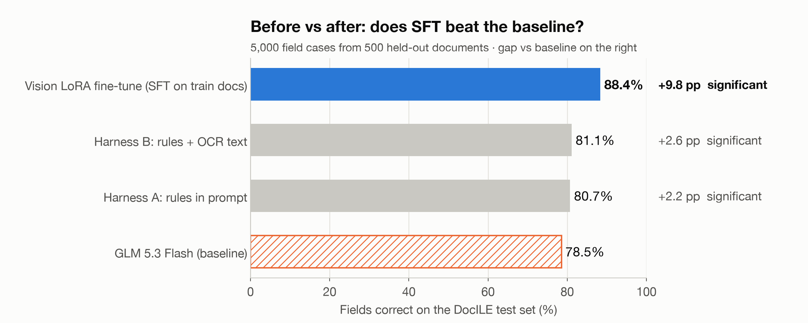
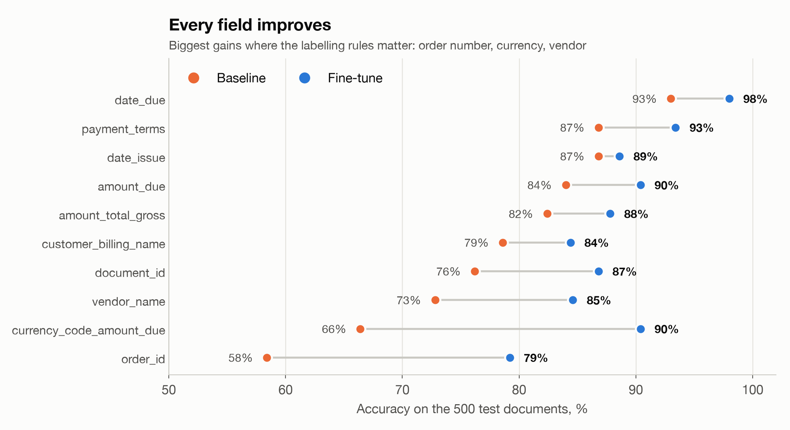
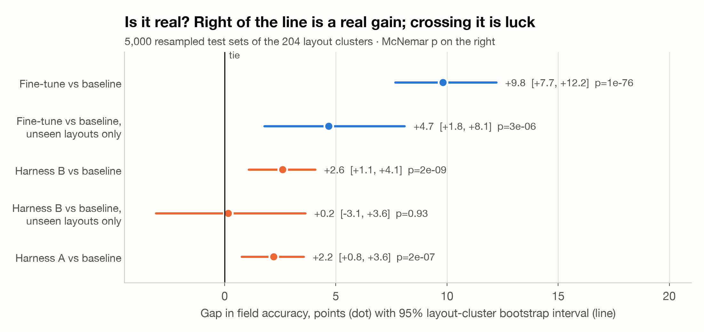

# DocILE invoice extraction: fine-tuning GLM 5.3 Flash on Fireworks

Accounts-payable clerks key the same ten fields off every invoice: invoice number, dates, vendor, customer, order number,
payment terms, totals and currency. We ask GLM 5.3 Flash to read those fields off real scanned business documents and
return JSON, try to improve it with prompting, then with a vision LoRA fine-tune on Fireworks serverless training, and
test every gain for statistical significance.

**Result:** fine-tuning took GLM 5.3 Flash from 78.5% to **88.4%** of fields correct (+9.8 points; McNemar
p = 1e-76, layout-cluster bootstrap 95% CI [+7.7, +12.2]). On layouts it never saw in training the gain is smaller but
still real (+4.7, CI [+1.8, +8.1]). Prompting with the labelling rules gained only +2.2 to +2.6, and traded one kind of
error for another. Total Fireworks spend: about $40.

**Why it matters:** an invoice skips human review only if every field is right. The fine-tune raises fully correct documents from 12.8% to **38.8%** (3x). See [docs/market-and-why-accuracy.md](docs/market-and-why-accuracy.md) for the market and value case.

## Data

[DocILE](https://docile.rossum.ai/) (Šimsa et al., [ICDAR 2023](https://arxiv.org/abs/2302.05658)) is a benchmark of real
business documents (mostly invoices and orders, many scanned in the 1990s–2000s) annotated by Rossum. Every field carries
its type, location and text. Documents are grouped into **layout clusters** (documents from the same template or vendor).

| Split | Documents | Layout clusters | Use |
| --- | --- | --- | --- |
| train | 5,180 | 1,003 | fine-tuning data (1,400 sampled, budget-capped) |
| **test** (official val split) | **500** | **204** | 5,000 field cases; 124 documents (60 clusters) on layouts never seen in training |

The official test split's labels are hidden behind the competition server, so the official validation split is our
locked test set. Nothing in it is used for training or prompt design.

**Task.** Input: page 1 of the document as an image (150 dpi, longest side 1,600 px). Output: a JSON object with 10 fields,
the most common single-answer DocILE field types:

| Field | Docs with it (test) |
| --- | --- |
| customer_billing_name | 96% |
| amount_total_gross | 93% |
| amount_due | 92% |
| vendor_name | 88% |
| date_issue | 86% |
| document_id | 76% |
| currency_code_amount_due | 66% |
| order_id | 39% |
| payment_terms | 31% |
| date_due | 14% |

**Scoring.** Each (document, field) pair is one pass/fail case, 5,000 in total. If the field is labelled on page 1, the
prediction must match any labelled instance after normalisation (amounts compared as numbers, dates as calendar dates,
currency symbols mapped to ISO codes, text compared case- and punctuation-insensitively; one line of a multi-line label
also counts). If the field is not labelled, the model must return null — this is what catches invented values.

## Results



All systems are GLM 5.3 Flash, scored on the same 5,000 field cases (500 test documents), temperature 0.

| System | Field accuracy | Present fields | Absent (null) | Unseen layouts | Gap vs baseline | Cost, 500 docs |
| --- | --- | --- | --- | --- | --- | --- |
| Baseline, plain prompt (1,600 px) | 78.5% | 85.8% | 64.8% | 79.9% | | $0.24 |
| Baseline, plain prompt (1,344 px) | 78.5% | 85.5% | 65.4% | 80.8% | ±0.0, not significant | $0.18 |
| Harness A: labelling rules in prompt | 80.7% | 82.8% | 76.8% | 80.6% | +2.2, significant | $0.25 |
| Harness B: rules + OCR text | 81.1% | 83.0% | 77.5% | 80.1% | +2.6, significant | $0.29 |
| **Vision LoRA fine-tune (1,344 px)** | **88.4%** | **89.2%** | **86.8%** | **85.5%** | **+9.8, significant** | scored in training session* |

\*Scored on Fireworks' serverless training sampler (~$3 at list price for the 500 documents), not a deployment.

| Comparison | Gap | Only A right / only B right | McNemar p | Layout-cluster bootstrap 95% CI |
| --- | --- | --- | --- | --- |
| Fine-tune vs baseline (same 1,344 px images) | +9.8 | 625 / 134 | 1e-76 | [+7.7, +12.2] |
| Fine-tune vs baseline, unseen layouts only | +4.7 | 105 / 47 | 3e-6 | [+1.8, +8.1] |
| Fine-tune vs Harness B (best prompt) | +7.2 | 506 / 144 | 4e-48 | [+5.7, +9.0] |
| Harness A vs baseline | +2.2 | 274 / 164 | 2e-7 | [+0.8, +3.6] |
| Harness B vs baseline | +2.6 | 301 / 171 | 2e-9 | [+1.1, +4.1] |
| Harness B vs baseline, unseen layouts only | +0.2 | 65 / 63 | 0.93 | [−3.1, +3.6] (tie) |
| Baseline 1,344 px vs 1,600 px | ±0.0 | 110 / 109 | 1.0 | [−0.7, +0.6] (tie) |

The fine-tune improves every one of the 10 fields:



| Field | Baseline | Harness B | Fine-tune |
| --- | --- | --- | --- |
| order_id | 58% | 67% | **79%** |
| currency_code_amount_due | 66% | 86% | **90%** |
| vendor_name | 73% | 76% | **85%** |
| document_id | 76% | 77% | **87%** |
| customer_billing_name | 79% | 79% | **84%** |
| amount_total_gross | 82% | 83% | **88%** |
| amount_due | 84% | 76% | **90%** |
| payment_terms | 87% | 86% | **93%** |
| date_issue | 87% | 87% | **89%** |
| date_due | 93% | 95% | **98%** |

Unlike prompting, the fine-tune got better at *both* kinds of case at once: it leaves absent fields null far more often
(65% → 87%) **and** reads present fields better (85.5% → 89.2%), where the rules prompt lost ground on present fields.

### How we decide a difference is real



Same two checks as the Forge sample; a difference counts only if it passes both.

- **Exact McNemar test** on the 5,000 field cases: of the cases where exactly one system is right, does one win far more
  often than a coin flip would? p < 0.05.
- **Layout-cluster bootstrap**: redraw the 204 test layout clusters with replacement 5,000 times and recompute the gap.
  The 95% interval must exclude zero. We resample clusters, not fields or documents, because documents from one template
  share their mistakes; treating them as independent would be overconfident.

### Prompting helped a little, and traded one error for another

Harness A spells out the labelling conventions the baseline gets wrong (extract only what is printed; currency only if a
symbol or code is printed; which number is the order number). Harness B adds DocILE's pre-computed OCR text. Both are
significant gains (+2.2 and +2.6), driven by currency (66% → 86%) and order number (58% → 67%), but the model became
too eager to answer null: amount_due fell from 85% to 75%, and accuracy on fields that are present fell from 85.8% to
83%. Neither gain is significant on unseen layouts.

### Fine-tuning

1,400 training documents, `[page image, prompt] → JSON` with the first labelled value of each field (null if absent).
Serverless vision LoRA on Fireworks: rank 16, learning rate 1e-4, 1 epoch, batch 16 (88 steps; training loss
0.37 → 0.04). The test set is scored on Fireworks' serverless sampler on the exact trained weights; see
[docs/lora-explained.md](docs/lora-explained.md) for a beginner's walkthrough of what that means.

**What went wrong first.** The in-session scoring of the first run failed on 495 of 500 documents with
`400 Bad Request`. The serverless sampler rejects any single image over 2,048 prompt tokens, while training accepts
larger ones; our 1,600 px pages were ~2,600 tokens. We re-scored the saved checkpoint at 1,344 px (near-square pages
capped at 1.45 MP, largest image 1,894 tokens) with `05_score_sft.py`, and re-ran the baseline at 1,344 px so the
headline comparison uses identical images. Downscaling made no difference to the baseline (78.5% both ways).
`04_sft.py` now checks every test image against the limit before training starts.

## Next step: hill-climbing with GEDD

Exact-match accuracy got us from 78.5% to 88.4%, but the remaining errors are exactly where a fixed metric stops being
trustworthy. Many are disagreements about *what counts as right*: the issuing division vs the parent company as
vendor, a printed invoice number the annotators left unlabelled, the total before or after commission. An AP team
would judge some of these as real errors, some as acceptable, and some as label gaps.

That's the problem [GEDD (Grounded Evidence Driven Development)](../README.md) is built for: turning domain-expert
judgment into calibrated scenarios and an LLM-as-Judge response gate. The plan for the next iteration:

1. **Baseline evidence.** Take the fine-tune's wrong fields on the test set (`results/results_glm_sft_1344.jsonl`).
2. **SME annotation.** An accounts-payable expert labels each one: real error, acceptable variant, or label gap.
3. **Failure codebook.** Turn those labels into codes, e.g. `WRONG_ORDER_NUMBER`, `INVENTED_CURRENCY`,
   `PRE_COMMISSION_TOTAL`, `DIVISION_VS_PARENT`, `LABEL_GAP`.
4. **Calibration set → judge.** Build a guardrail calibration set and an LLM-as-Judge that decides, per extracted
   invoice, *post to the AP system*, *block*, or *send to human review*, and measure it before it becomes a blocking control.
5. **Hill-climb.** Feed the confirmed failures back as new SFT examples and corrected labels, re-train, and re-run the
   same locked test set plus the GEDD judge, keeping the McNemar + cluster-bootstrap bar for every claimed gain.

The fine-tune makes the model better at the house rules; GEDD makes the house rules explicit, measurable and owned by
the people who know them.

The full round-2 plan (error breakdown, which of SFT / DPO / RL / decision tuning fixes what, costs and guardrails)
is in [docs/roadmap-sft-dpo-gedd.md](docs/roadmap-sft-dpo-gedd.md).

## Cost

Total Fireworks spend was kept under a hard $50 cap. `04_sft.py` estimates the whole run before starting and stops
training if it would exceed `--max-usd`.

| Item | USD (list price) |
| --- | --- |
| Baseline, 500 docs (1.39M input tokens) | ~0.24 |
| Harness A + B | ~0.54 |
| Fine-tune: 4.02M training tokens at $8.89/M | ~35.76 |
| Failed first scoring pass (5 of 500 succeeded) | <0.10 |
| Re-scoring the fine-tune at 1,344 px | ~3.0 |
| Baseline re-run at 1,344 px | ~0.18 |
| **Total** | **~$40** (estimate from token counts at list price; check the Fireworks billing page) |

## Caveats

- **No closed frontier baseline.** We had no budget for closed-model APIs, so we don't claim to beat GPT, Claude or Gemini.
  `02b_frontier.py` runs them through OpenRouter on the same prompt and test set for anyone with a key.
- **Our task, not the official one.** DocILE's official KILE track scores bounding-box localisation with AP; we score
  extracted text. These numbers are not comparable with published DocILE results.
- **Label noise.** Some "absent" labels look like annotation gaps (a printed invoice number left unlabelled). It affects
  every system equally, which is why we also report accuracy on present fields only.
- **Page 1 only.** Fields that appear only on later pages are dropped from the labels (21% of test documents have more
  than one page).
- **Resolution mismatch.** The fine-tune was trained on 1,600 px pages but scored on 1,344 px pages (sampler limit).
  If anything this handicaps the fine-tune; the baseline is unaffected by the downscale.
- **Budget-limited training.** 1,400 of 5,180 training documents, one seed, no hyperparameter sweep.
- **Seen layouts.** 376 of 500 test documents come from layout clusters that also appear in training; we report the
  124 unseen-layout documents separately.
- **Licence.** Code here is ours; the DocILE data, labels and scans are not redistributed — download it yourself with a token from
  docile.rossum.ai and check its terms.

## Run it

```bash
uv sync && uv pip install -e cookbook/training   # cookbook: git clone https://github.com/fw-ai/cookbook
echo 'FIREWORKS_API_KEY=...' > .env
git clone https://github.com/rossumai/docile /tmp/docile
/tmp/docile/download_dataset.sh TOKEN annotated-trainval data/docile --unzip   # needs poppler (pdftoppm)
```

| Script | What it does | Fireworks cost |
| --- | --- | --- |
| `01_build_splits.py` | Reads the official labels, builds `splits/train.jsonl` and `splits/test.jsonl` | free |
| `02_baseline.py` | Base GLM 5.3 Flash on the 500 test documents (also run with `DOCILE_MAX_SIDE=1344`, tag `glm_1344`) | ~$0.24 |
| `02b_frontier.py` | Optional: Gemini / Claude / GPT via OpenRouter (not run) | OpenRouter |
| `03_harness.py` | Prompt ideas A and B | ~$0.54 |
| `04_sft.py` | Vision LoRA fine-tune, in-session test scoring, promotion. `--dry-run` prints the cost estimate. Run with `DOCILE_MAX_SIDE=1344` | ~$36–41 |
| `05_score_sft.py` | Re-score a saved checkpoint on the test set (bounded concurrency, retries, cached). `DOCILE_MAX_SIDE=1344` | ~$3 |
| `06_report.py` | Leaderboard, McNemar, cluster bootstrap, per-field table | free |
| `07_charts.py` | Figures | free |
| `08_rigor.py` | Holm-adjusted comparisons, minimum detectable effect, error taxonomy, document-level success → `results/rigor.json` | free |
| `09_reward_gate_ppi.py` | Pilot: codebook vs scalar reward at the gate, PPI++ coverage, using the saved predictions → `results/reward_gate_ppi.json` | free |
| `10_bon_overopt.py` | E2: codebook vs scalar LLM-judge rewards under best-of-N (`estimate`, `sample`, `judge`, `analyse`) | ~$12 |
| `11_expert_kit.py` | Two-expert review sheets for the remaining errors; Krippendorff's alpha; re-scoring under corrected labels | free (expert time) |

Results are cached per document in `results/*.jsonl` (one row per document, with every field's prediction and score). The DocILE label text (`gold`) and `splits/` are not published here, per the dataset's terms; `01_build_splits.py` rebuilds them from your own DocILE download, and re-running the eval restores `gold`.

| File | What it does |
| --- | --- |
| `dl_common.py` | Data, rendering, prompt, JSON parsing, normalisation, grading, cached async eval |

## Disclosure

Built during the hackathon. The pipeline structure, training loop and statistical tests follow the Forge sample
submission ([sinanuozdemir/ai-experiments](https://github.com/sinanuozdemir/ai-experiments),
`floorplancad-symbol-counting`). Code was written with an AI coding assistant (Claude Code).
